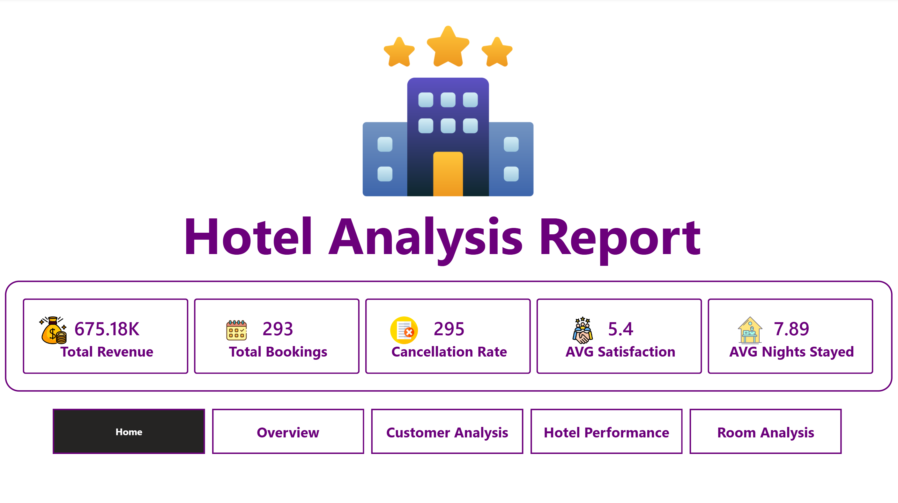
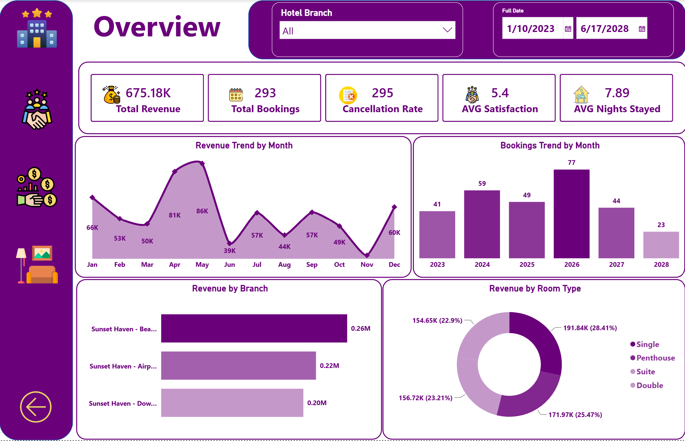
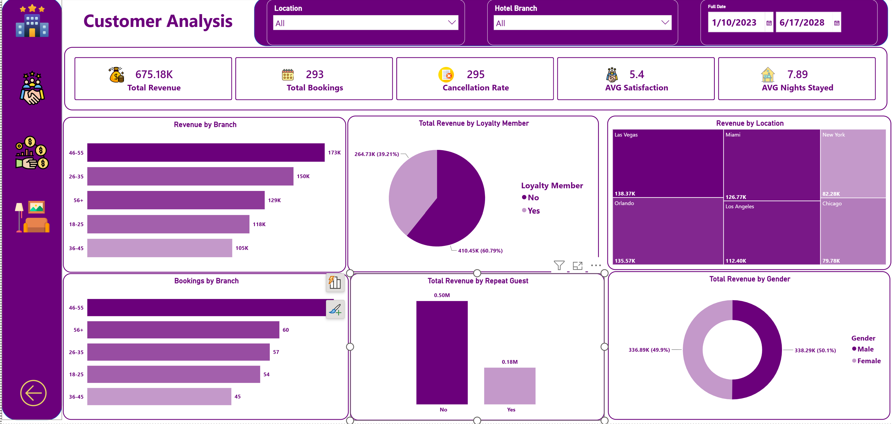
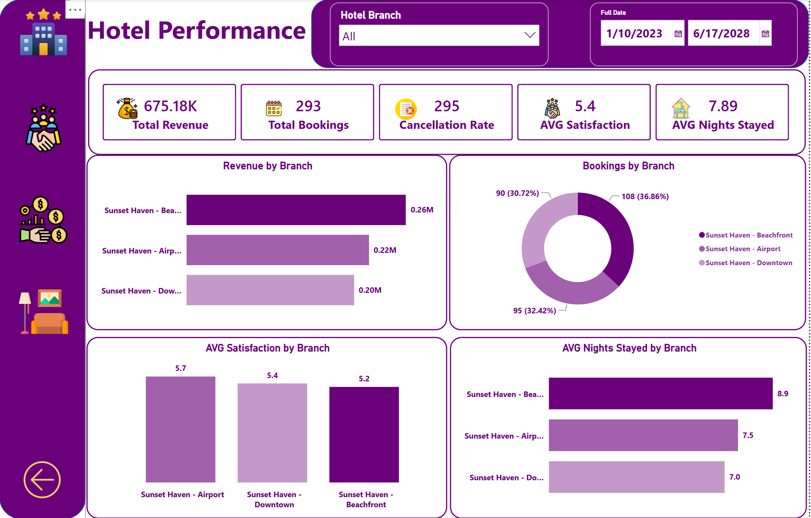
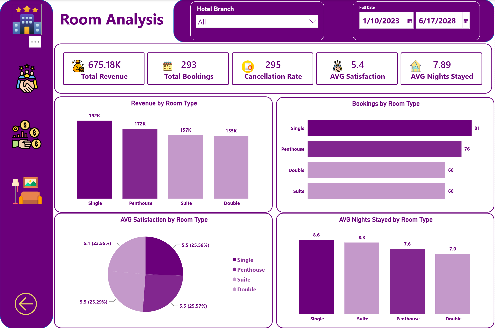

# 🏨 Hotel Booking & Performance Analytics Hub

---

### 👤 Created By:
**Ebrahim Mustafa** — *Data Analyst & BI Analyst*

---

## 📌 نبذة عن المشروع (Project Overview)
يهدف هذا المشروع إلى تقديم تحليل استراتيجي متكامل لأداء سلسلة الفنادق (**Hotel Analysis Report**)، لمتابعة الإيرادات الكلية (**\$675.18K**)، سلوك الحجوزات (**293 Bookings**)، معدلات الإلغاء مرتفعة الخطورة (**295 Cancellations**)، قياس تقييمات وجدة رضا العملاء (**5.4 AVG Satisfaction**)، ومتوسط الليالي المحجوزة (**7.89 Nights**)[cite: 26, 27, 28, 29, 30].

تم بناء التقرير واختيار الهوية البصرية بنظام الصفحات المتعددة التفاعلية (Multi-Page Interactive Dashboard) لتوفير تجربة مستخدم (UI/UX) مرنة وسلسة للقيادات التنفيذية ومسؤولي إدارة الفنادق[cite: 26, 27, 28, 29, 30].

---

## 🛠️ أدوات وتقنيات العمل (Tech Stack & Methodology)

* **Power Query (ETL Process):**
  * استيراد بيانات الحجوزات والتأكد من جودتها.
  * تنظيف البيانات وتصحيح التنسيقات وإنشاء الأعمدة المحسوبة (Calculated Columns).
  * إعادة هيكلة الجداول لتجهيزها لعملية النمذجة.

* **Data Modeling & DAX Measures:**
  * بناء نموذج بيانات متكامل (**Star Schema**) يربط بين جدول الحقائق وجداول الأبعاد بعلاقات (1-to-Many).
  * صياغة مقاييس حسابية ديناميكية باستخدام **DAX** لحساب إجمالي الإيرادات، معدلات الإلغاء، متوسط مدة الإقامة، وتقييمات الرضا.

* **Figma & UI/UX Design:**
  * تصميم واجهات ومكونات الخلفية والأزرار والقوائم الجانبية الاحترافية وتناسق درجات البنفسجي المودرن.

* **Power BI Interactive Reporting:**
  * بناء وتطوير لوحات المؤشرات التفاعلية وربط عناصر التقرير بالسلايسرز والفلاتر الزمنية والجغرافية.

---

## 🚀 صفحات التقرير (Dashboard Pages)

### 1️⃣ الصفحة الرئيسية (Home Page)
صفحة ترحيبية وتوجيهية تعرض مؤشرات الأداء الرئيسية (KPI Cards) مع خيارات التنقل السريع بين أقسام التقرير المختلفة[cite: 26].

---

### 2️⃣ صفحة النظرة العامة (Overview)
متابعة اتجاهات الإيرادات الحجمية عبر الشهور (Revenue Trend by Month)، اتجاه الحجوزات حسب الأعوام (Bookings Trend by Month)، إيرادات الفروع، وتوزيع الإيرادات حسب نوع الغرف (Single, Penthouse, Suite, Double)[cite: 27].

---

### 3️⃣ صفحة تحليل العملاء (Customer Analysis)
تحليل سلوك النزلاء حسب الفئات العمرية (Age Groups)، التوزيع حسب الموقع الجغرافي (Las Vegas, Miami, Orlando..)، نسبة أعضاء برنامج الولاء (Loyalty Members)، والنمط التكراري للزيارة (Repeat Guests)[cite: 28].

---

### 4️⃣ صفحة أداء الفنادق (Hotel Performance)
مقارنة شاملة بين فروع السلسلة (`Beachfront`, `Airport`, `Downtown`) من حيث إجمالي الإيرادات، توزيع الحجوزات، معدلات الرضا، ومتوسط الإقامة[cite: 29].

---

### 5️⃣ صفحة تحليل الغرف (Room Analysis)
تقييم تفصيلي لأداء كل نوع من أنواع الغرف (Single, Penthouse, Suite, Double) من حيث الإيرادات المباشرة، عدد الحجوزات، متوسط رضا النزلاء، ومتوسط الليالي المقضاة لكل غرفة[cite: 30].

---

## 💡 الرؤى الاستراتيجية والتوصيات (Business Insights & Recommendations)

1. **معالجة ارتفاع معدل الإلغاء (High Cancellation Rate Problem):**
   * **الرؤية:** عدد طلبات الإلغاء (**295 إلغاء**) يتجاوز إجمالي الحجوزات المؤكدة (**293 حجز**)، مما يمثل استنزافاً كبيراً للإيرادات الممكنة وفرص الإشغال[cite: 26, 27, 28, 29, 30].
   * **التوصية:** تطبيق سياسات إلغاء مرنة ولكن بشروط (Non-refundable deposits)، وإرسال تأكيدات تلقائية عبر البريد الإلكتروني مع تقديم حوافز للالتزام بالحجز.

2. **تحسين أداء الفروع والتركيز على الفرع الأكثر ربحية:**
   * **الرؤية:** فرع الشاطئ **Sunset Haven - Beachfront** يسيطر على أعلى نسبة إيرادات (**\$0.26M** أرباح ومتوسط إقامة **8.9 ليالي**)، بينما يسجل فرع وسط المدينة **Downtown** أدنى إيرادات (**\$0.20M**)[cite: 27, 29].
   * **التوصية:** تعزيز الحملات الترويجية لفرع الشاطئ، وإعادة النظر في تسعير وخدمات فرع وسط المدينة لرفع جاذبيته لرجال الأعمال والمسافرين[cite: 27, 29].

3. **تطوير برنامج الولاء والنزلاء المكررين (Loyalty & Repeat Guests):**
   * **الرؤية:** الإيرادات القادمة من غير الأعضاء ببرنامج الولاء تبلغ **\$410.45K (60.79%)**، والنزلاء غير المكررين يمثلون الجانب الأكبر من الإيرادات (**\$0.50M**)[cite: 28].
   * **التوصية:** تقديم خصومات حصرية وتسهيلات تسجيل دخول (Check-in) للنزلاء لتحويل الجدد إلى أعضاء دائمين في برنامج الولاء لزيادة القيمة الممتدة للعميل (LTV)[cite: 28].

4. **رفع تقييم رضا العملاء (Customer Satisfaction Enhancement):**
   * **الرؤية:** متوسط رضا العملاء يقف عند **5.4 من 10** وهو معدل متوسط يحتاج لتدخل سريع، مع ملاحظة أن أطول فترة إقامة تكون في الغرف الفردية **Single Rooms** بمتوسط **8.6 ليالي**[cite: 26, 27, 28, 29, 30].
   * **التوصية:** تحسين خدمات الغرف والصيانة الدورية بناءً على استبيانات النزلاء، وتقديم خدمات مضافة لغرف الـ Penthouse و Suites لرفع معدل التقييم العام[cite: 30].

---

### ✍️ Created By:
**Ebrahim Mustafa — Data Analyst & BI Analyst**
